# Dengar.in — CareBridge Structure & Mermaid Architecture

**Versi:** 2.1 (development blueprint + CB-035 Google DeepMind Gemma bonus)  
**Tanggal acuan:** 14 Oktober 2026  
**Repository:** https://github.com/iqbalscript/Denger.in-Web-Project  
**Aplikasi:** https://dengar-in.vercel.app  
**Basis audit:** `main` commit `76e760e09d2f` (terlihat pada 14 Oktober 2026)  
**Dokumen pasangan:** `DENGARIN_CAREBRIDGE_PRD_V2_TOKEN_FACTORY.md`  
**Status:** blueprint; bukan konfirmasi implementasi atau deployment AMD/Gemma.

**Update 14 Oktober 2026:** Jalur **AMD Token Factory tetap utama**; diagram tambahan di §11.1 menggambarkan **Gemma pada AMD GPU + ROCm** untuk bonus Google secara **opsional**, hanya setelah aturan hadiah dan infrastruktur benar-benar diverifikasi. Gemma ≠ Gemini API. Task: `CB-035` pada PRD dan `CB-035_GOOGLE_DEEPMIND_GEMMA_AMD.md`.

> **Notasi:** `[EXISTING]` = file/alur ditemukan di repository; `[ENHANCE]` = peningkatan yang diminta; `[NEW]` = belum ditemukan; `[VERIFY]` = butuh uji pada deployment nyata. Panah atau diagram menggambarkan desain target bila diberi label *Target*.

## 1. Prinsip arsitektur

CareBridge adalah workflow persiapan konsultasi, **bukan** chatbot diagnosis. Model di **AMD Token Factory** bertugas mengusulkan draf Care Passport; Dengar.in tetap mengendalikan consent, pemeriksaan krisis, redaksi PII, validasi kutipan, kebutuhan review manusia, dan ekspor. Tidak ada transfer catatan ke psikolog ataupun panel klinis sungguhan.

- **Client:** React/Next.js 15 di Vercel, state sementara di komponen; jurnal dan check-in bersumber dari localStorage dan dikirim hanya setelah dipilih.
- **Server:** Next.js route handlers menerapkan validasi batas payload, rate limit, crisis gate, redaksi server-side, dan validasi output AI.
- **Inference:** `createAmdProvider()` memakai protokol OpenAI-compatible, dengan **URL dan model sebenarnya dari portal Token Factory**, bukan URL tebakan.
- **Penyimpanan:** Workflow Care Passport saat ini tidak memerlukan tabel database baru. Isi paspor **tidak** dipersist ke server; log hanya metadata. Ekspor `.md` dan `.txt` terjadi di browser setelah persetujuan.
- **Trust boundary:** Browser dan model AI adalah sumber data tak tepercaya. Persetujuan dan klaim yang berasal dari model tidak bisa mengalahkan gerbang deterministik.

## 2. Diagram konteks sistem — existing + target AMD

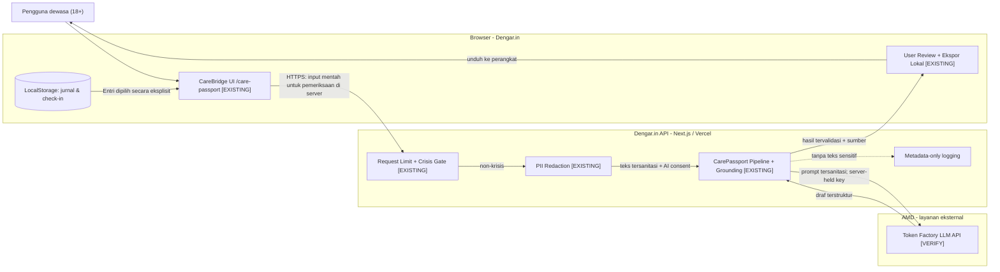

**Catatan:** teks mentah dari browser memang diterima oleh **server Dengar.in** untuk pemeriksaan awal. Yang dilarang adalah meneruskan teks mentah/PII terdeteksi ke **provider AI**. Token Factory adalah layanan terkelola pihak AMD; jangan menggambarkannya sebagai server pribadi tim.

## 3. Sitemap dan discoverability

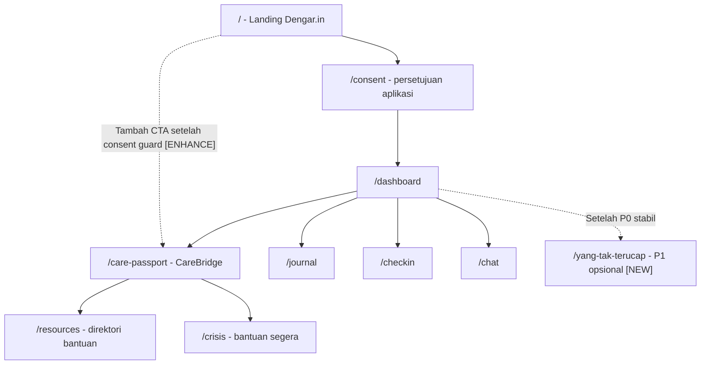

**Gap nyata:** link `/care-passport` sudah ada di `Navbar.tsx`, tetapi di navigasi desktop diberi `hidden 2xl:inline-flex`. Di landing, CTA utama tetap menuju `/consent`. Solusinya **CTA jelas ke CareBridge** setelah guard, bukan mengganti alur persetujuan aplikasi.

## 4. User journey / wizard

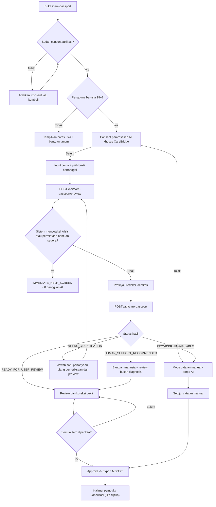

**Perlu konsistensi terminologi:** `PROVIDER_UNAVAILABLE` saat user menolak AI adalah state kode existing, tetapi tampilan harus mengatakan **"Kamu memilih mode tanpa AI"**, bukan "server sedang rusak". Jalur manual tetap tersedia.

## 5. Urutan request dan batas keamanan

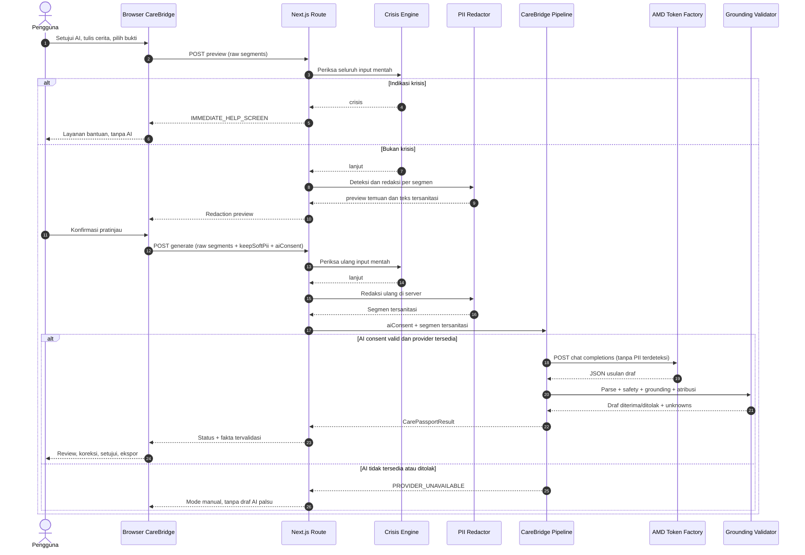

## 6. Diagram state API — lima state saat ini

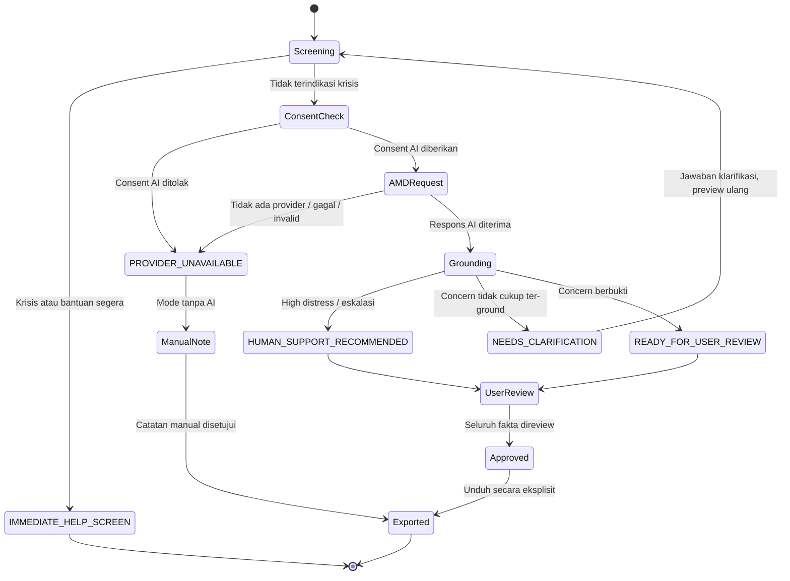

Tiga catatan: (1) *high distress* saat ini dibolehkan menghasilkan draf tetapi selalu ditandai saran dukungan manusia—**kebijakan ini perlu sign-off Safety/QA**; (2) AI hanya boleh eskalasi; (3) state ini bukan diagnosis ataupun penilaian risiko klinis.

## 7. Alur data, sumber fakta, dan penanganan unknown

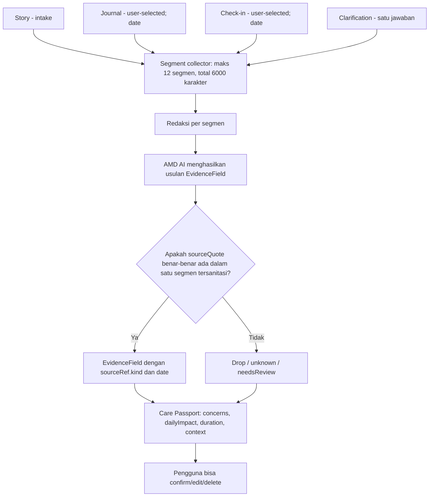

Contoh data yang **sudah ada** di `packages/types/src/index.ts`: `CarePassportSegment`, `EvidenceField`, `EvidenceRef`, `CarePassportResult`. `sourceQuote` berasal dari teks tersanitasi, `reviewStatus` tidak pernah bisa ditetapkan `user_approved` oleh AI, dan `completeness` adalah **jumlah fakta diketahui, bukan persentase keyakinan model**.

## 8. Struktur komponen layar (target UI)

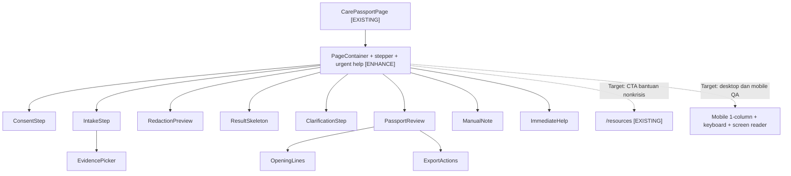

Komponen pada diagram **sebagian besar sudah ada**. Tidak perlu membuatnya lagi; PRD menjelaskan refactoring yang relevan.

## 9. Wireframe layar berbasis Markdown (bukan desain grafis final)

### 9.1 Desktop: input dan bukti

```text
+-------------------------------------------------------------------------+
| DENGAR.IN      Catatan Konsultasi                         Butuh bantuan? |
+-------------------------------------------------------------------------+
|  Langkah 2/4: Ceritamu             |  Privasi & Bukti                  |
|                                    |                                    |
|  Apa yang ingin kamu sampaikan?    |  Jurnal dan check-in (opsional)    |
|  +------------------------------+  |  [ ] Jurnal 10 Okt                |
|  | Tulis dengan kata-katamu...  |  |  [x] Check-in 12 Okt             |
|  |                              |  |  [ ] Jurnal 13 Okt                |
|  +------------------------------+  |  Maks 12 segmen / 6000 karakter   |
|  [Kembali]      [Cek privasi ->]   |  Tanpa dipilih: tidak dikirim     |
+-------------------------------------------------------------------------+
| Ini bukan diagnosis atau layanan darurat.                               |
+-------------------------------------------------------------------------+
```

### 9.2 Desktop: hasil untuk ditinjau

```text
+-------------------------------------------------------------------------+
| Catatan untuk konsultasi                 [Diproses AMD]*  [Butuh bantuan]|
| Status: PERLU DITINJAU   Kelengkapan: 2 dari 3 hal utama diketahui       |
+-------------------------------------------------------------------------+
| Informasi utama               | Belum diketahui / tindak lanjut         |
| - Keluhan                     | - Sejak kapan dirasakan?                 |
|   Bukti: "..." (cerita)       | - Punya pertanyaan untuk profesional?   |
|   [Benar] [Ubah] [Hapus]      |                                          |
| - Dampak                     | Bantuan manusia tersedia               |
|   Bukti: "..." (check-in)     | [Lihat direktori bantuan]               |
|   [Benar] [Ubah] [Hapus]      |                                          |
+-------------------------------------------------------------------------+
| [Mulai ulang]  [Setujui setelah pemeriksaan]  -> [Ekspor MD/TXT]         |
+-------------------------------------------------------------------------+
| *Label AMD hanya bila inference AMD asli terbukti pada respons tersebut. |
+-------------------------------------------------------------------------+
```

### 9.3 Mobile

```text
+--------------------------+
| Dengar.in      Bantuan   |
| Catatan Konsultasi       |
| Langkah 2 dari 4         |
| +----------------------+ |
| | Cerita pengguna      | |
| +----------------------+ |
| Bukti (opsional)         |
| [ ] Jurnal 10 Okt        |
| [x] Check-in 12 Okt      |
|                          |
| [Cek privasi]            |
| [Kembali]               |
+--------------------------+
```

Target: tanpa horizontal scroll pada viewport 320px, tombol target sentuh min. 44x44 px, focus ring jelas, step label yang dapat dibaca screen reader, loading/error dalam `role="status"` / `role="alert"`, keyboard usable. Pakai identitas desain Dengar.in yang berlaku, bukan memaksakan ulang font lama dari dokumen desain yang sudah ketinggalan.

## 10. Batas penyimpanan dan deployment

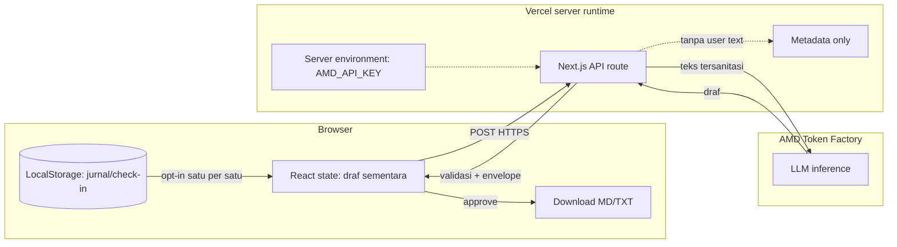

**Tidak perlu tabel baru** khusus Care Passport pada MVP. Jika nanti menambah draft persistence, itu *feature request* baru dengan DPIA/threat-model, enkripsi, retensi, kontrol penghapusan, serta consent yang eksplisit. Data analitik jangan pernah berisi cerita, source quote, atau NIK/nomor/email.

## 11. Deployment dan koneksi AMD (target)

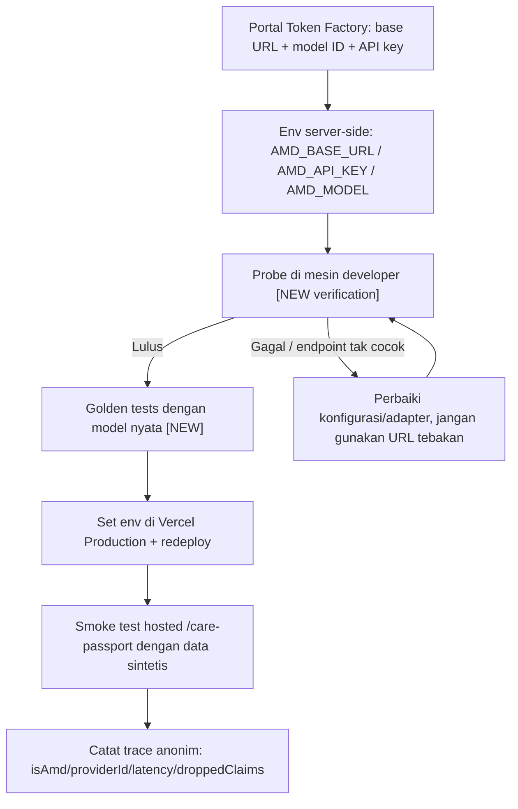

### 11.1 Jalur bonus Google DeepMind Gemma di AMD GPU / ROCm — **[NEW, OPTIONAL]**

> **Pemisahan penting:** diagram ini **target desain**, bukan deployment saat ini. Jalur Gemma untuk bonus Google berjalan terpisah dari Token Factory. Pilihan provider di bawah dikontrol konfigurasi server serta disclosure/consent, **bukan** input base URL dari browser dan **bukan** fallback diam-diam.

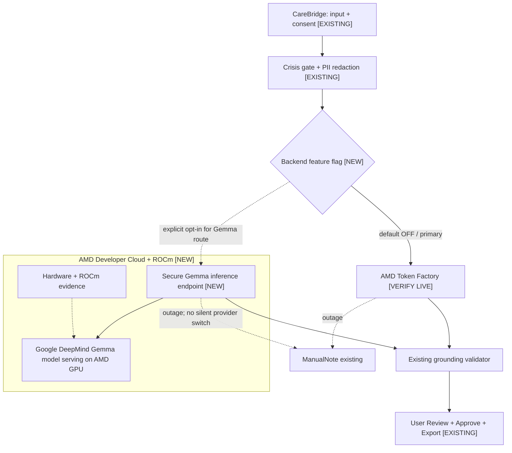

```mermaid
sequenceDiagram
    participant U as User (CareBridge UI)
    participant V as Next.js Backend
    participant G as Crisis & PII safeguards
    participant A as Gemma on AMD GPU (ROCm)
    participant Q as Grounding Validator
    U->>V: Consent + synthetic story (test/staging)
    V->>G: Crisis gate pada teks mentah
    alt Crisis / urgent help
        G-->>U: Immediate help; 0 inference calls
    else Aman lanjut, AI consent diberikan
        G->>G: PII redaction server-side
        G-->>V: Sanitized text
        V->>A: Structured draft generation (authenticated HTTPS)
        A-->>V: Candidate draft + provider metadata
        V->>Q: Validate evidence and claims
        Q-->>V: Approved candidate OR unavailable
        V-->>U: 5-state CarePassportResult
        U->>U: Review / edit / approve / local export
    end
```

**Rencana file (belum ada pada kode):** konfigurasi env `GEMMA_AMD_BASE_URL`, `GEMMA_AMD_MODEL`, `GEMMA_AMD_API_KEY` dan feature flag `CAREBRIDGE_GEMMA_ENABLED=false`; gunakan kembali `services/orchestrator/src/providers/amdProvider.ts` jika protokol cocok, atau lapisan provider minimal bila perlu. Semua rahasia disimpan di server. Deploy Gemma di lingkungan GPU AMD/ROCm yang benar-benar dapat diakses aman dari Vercel; endpoint yang hanya mendengarkan localhost pada GPU VM tidak otomatis dapat diakses Vercel.

**Kriteria selesai:** real Gemma completion dari GPU AMD, bukti ROCm/GPU instance yang sama, verifikasi aturan Google prize, tidak ada data sensitif di log/provider, lulus safety/grounding E2E, dan demo yang menampilkan kontribusi nyata teknologi Gemma. Jika gagal/terblokir, jalur utama **Token Factory + ManualNote** tidak boleh ikut rusak. Lihat PRD §12.4.

Rute yang sudah ada:

| Rute | Fungsi | Catatan |
|---|---|---|
| `POST /api/care-passport/preview` | Crisis gate + PII preview | Tidak memanggil AMD |
| `POST /api/care-passport` | Generate + grounding + state | AMD jika consent dan provider siap |
| `POST /api/care-passport/opening` | Kalimat pembuka dari passport disetujui | AMD atau fallback template berlabel |
| `GET /api/health` | Liveness + Redis status | **Tidak** membuktikan Token Factory sehat |
| `/care-passport` | Wizard di browser | Existing |

## 12. Struktur folder — existing vs target

```text
Denger.in-Web-Project/
├── apps/web/src/
│   ├── app/
│   │   ├── care-passport/page.tsx                  [EXISTING]
│   │   ├── api/care-passport/route.ts             [EXISTING]
│   │   ├── api/care-passport/preview/route.ts     [EXISTING]
│   │   ├── api/care-passport/opening/route.ts     [EXISTING]
│   │   ├── dashboard/page.tsx                    [EXISTING; CTA ENHANCE]
│   │   └── page.tsx                              [EXISTING; consent-gap FIX]
│   ├── components/carePassport/
│   │   ├── ConsentStep.tsx                        [EXISTING]
│   │   ├── IntakeStep.tsx                         [EXISTING]
│   │   ├── EvidencePicker.tsx                     [EXISTING]
│   │   ├── RedactionPreview.tsx                   [EXISTING]
│   │   ├── ClarificationStep.tsx                  [EXISTING]
│   │   ├── PassportReview.tsx                     [EXISTING]
│   │   ├── OpeningLines.tsx                       [EXISTING]
│   │   ├── ManualNote.tsx                         [EXISTING]
│   │   └── ExportActions.tsx                      [EXISTING]
│   └── lib/
│       ├── api/carePassportHandler.ts            [EXISTING]
│       ├── api/carePassportRoute.ts              [EXISTING]
│       ├── carePassportClient.ts                  [EXISTING]
│       └── carePassportExport.ts                  [EXISTING]
├── services/
│   ├── orchestrator/src/
│   │   ├── providers/amdProvider.ts               [EXISTING; real probe VERIFY]
│   │   ├── carePassportPipeline.ts                [EXISTING]
│   │   └── openingLinesPipeline.ts                [EXISTING]
│   ├── validator/src/
│   │   ├── piiRedactor.ts                         [EXISTING]
│   │   └── carePassport.ts                        [EXISTING]
│   └── crisis-engine/src/crisisDetector.ts        [EXISTING]
├── packages/types/src/index.ts                   [EXISTING]
├── tests/carebridge/                             [EXISTING; real-model eval NEW]
├── docs/
│   ├── DENGARIN_CAREBRIDGE_STRUCTURE_MERMAID.md   [NEW blueprint - this file]
│   └── DENGARIN_CAREBRIDGE_PRD_V2_TOKEN_FACTORY.md[NEW PRD]
└── .env.example                                  [EXISTING; review copy]
```

Folder tree di atas berfungsi sebagai **peta implementasi**, bukan klaim bahwa dua file dokumen ini sudah ditambahkan ke GitHub.

## 13. Refactoring boundaries

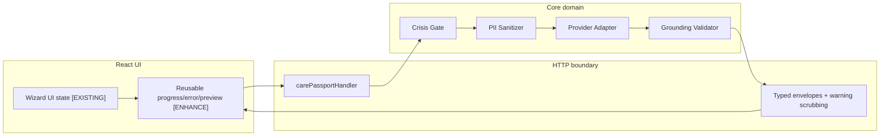

Refactor **dengan test regresi**, bukan rewrite menyeluruh. Jangan mencampur `CarePassportResult` dengan `LLMProviderResponse`; batasi semua data model lewat validator sebelum keluar ke UI.

## 14. Diagram lintasan pengembangan

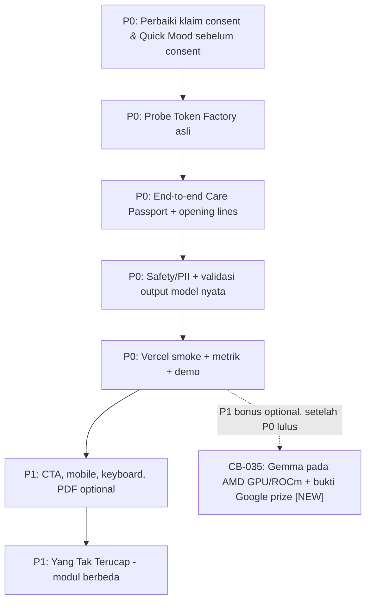

## 15. Sumber kode untuk ditelusuri

- `README.md` — fitur, arsitektur, dan status integrasi saat audit.
- `docs/AMD_SETUP.md` — adaptasi Token Factory; URL/model key harus dibaca dari portal yang login.
- `docs/CAREBRIDGE_SAFETY_POLICY.md` — kebijakan keselamatan; bagian high distress masih perlu sign-off.
- `docs/CAREBRIDGE_EVAL_RUBRIC.md` — kasus A–E, 20 skenario atribusi, dan hasil tes mock yang dilaporkan sebelumnya.
- `apps/web/src/app/care-passport/page.tsx` — wizard aktual.
- `services/orchestrator/src/providers/amdProvider.ts` — adapter, probe, dan konfigurasi.
- `packages/types/src/index.ts` — kontrak data canonical.

**Penggunaan:** Markdown ini bisa langsung dibuka dalam preview Mermaid GitHub atau aplikasi yang mendukung Mermaid. Diagram adalah dokumentasi sumber yang dapat diedit; belum diekspor ke Figma atau gambar statis.
