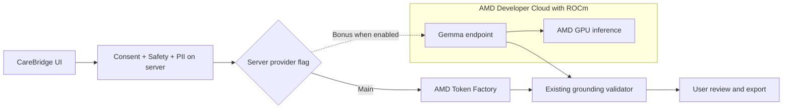

# CB-035 — Google DeepMind Gemma pada AMD GPU + ROCm (Bonus Prize)

**Type:** Enhancement / Optional Partner Prize  
**Priority:** P1 — hanya setelah P0 CareBridge Token Factory stabil  
**Status:** TODO / VERIFY  
**Owner:** AMD/AI Engineer (lead); DevOps; QA/Safety; PM  
**Dependency:** CB-015; ketersediaan AMD GPU/ROCm; syarat Google prize yang diverifikasi  
**Repo:** https://github.com/iqbalscript/Denger.in-Web-Project

## User story

Sebagai pengguna dewasa Dengar.in, saya dapat menyusun Care Passport dengan kualitas serta perlindungan privasi yang sama ketika engine yang digunakan adalah **Gemma dari Google DeepMind yang benar-benar berjalan pada GPU AMD**. Saya tetap dapat meninjau, mengoreksi, menyetujui, dan mengekspor hasil; tidak ada diagnosis otomatis.

## Motivasi

Pengumuman partner hackathon 14 Oktober 2026 menyebut dukungan Google DeepMind untuk **Gemma on AMD Developer Cloud + ROCm** dan peluang hadiah tambahan. Halaman resmi hackathon menampilkan Google prize $5.000, namun rincian eligibility harus dikonfirmasi organizer: https://lablab.ai/ai-hackathons/amd-developer-hackathon-act-iii. Jangan menyamakan Gemma dengan Gemini API atau mengklaim eligibility hanya karena API/token sudah tersedia.

## Checklist implementasi (satu issue)

- [ ] Konfirmasi aturan bonus Google secara tertulis (model, hardware, deadline, submission, evidence), dan lisensi/terms model Gemma yang dipakai.
- [ ] Dapatkan instance AMD GPU yang sesuai; bukti `rocminfo` / `rocm-smi` dan versi runtime ROCm dari mesin pelayan model.
- [ ] Verifikasi model exact ID/varian/versi Gemma dan kompatibilitas GPU/ROCm. Jalankan serving via vLLM jika didukung; jika tidak, pakai server inferensi kompatibel yang terverifikasi.
- [ ] Deploy inference endpoint aman: auth, HTTPS, tidak mengekspos port terbuka tanpa proteksi, healthcheck, timeout, penggunaan resource dan rencana stop instance.
- [ ] Tambahkan flag backend **default OFF** untuk memilih Gemma secara eksplisit. Usulan env baru (`GEMMA_AMD_BASE_URL`, `GEMMA_AMD_API_KEY`, `GEMMA_AMD_MODEL`, `CAREBRIDGE_GEMMA_ENABLED=false`) belum ada dalam repository dan harus diimplementasikan serta dites.
- [ ] Reuse kontrak `LLMProvider` dan `createAmdProvider` jika cocok; jangan membuat route API publik mentah atau menyisipkan key ke frontend.
- [ ] Pelihara urutan crisis gate pada raw text → AI consent → PII redaction di server → Gemma inference → validator → user review/approve/export.
- [ ] Jalankan golden cases A–E, high distress, 20 attribution scenarios, prompt injection, 401/429/timeout/5xx, serta tes browser E2E **menggunakan data sintetis**.
- [ ] Bukti: 0 model calls pada kasus krisis, 0 kebocoran PII terdeteksi ke model/log, 0 unsupported factual claims lolos validator dalam corpus uji; catat keterbatasan corpus.
- [ ] Rekam latency p50/p95, N sampel, success/failure/parse rate dan dropped claims tanpa prompt atau user text di logs.
- [ ] Siapkan demo end-to-end + bukti hardware AMD/ROCm/model Gemma, perbarui README dan pitch **hanya berdasarkan trace nyata**.
- [ ] Buktikan rollback/matikan Gemma tidak mengubah atau merusak jalur utama AMD Token Factory maupun mode manual.

## Diagram

## Definition of Done

- Bukti model Gemma berjalan pada GPU AMD dengan ROCm, disertai tanggal/versi/metadata yang dapat direproduksi.
- `CarePassportResult` existing dan lima state tidak berubah; semua safety tests lulus, termasuk crisis no-provider-call.
- Input asli pengguna dan API key tidak tercetak di log dan tidak terekspos dalam browser.
- Inferensi Gemma menghasilkan Care Passport nyata pada deployment uji, bukan mock atau sekadar screenshot playground.
- Dokumentasi dan video menautkan trace, model ID, hardware AMD, hasil benchmark riil dan limitations.
- Konfirmasi bahwa implementasi memenuhi syarat Google partner prize, atau status tetap `VERIFY`, bukan "eligible".
- Jalur Token Factory tetap berjalan ketika fitur bonus dimatikan.

## Explicit non-goals

Tidak melakukan diagnosis, terapi/resep, tidak menambah chatbot klinis atau review staf palsu, tidak mengganti Gemini API menjadi bukti Gemma, tidak melakukan fallback provider diam-diam, dan tidak memaksa migrasi semua chat Dengar.in.

**Related docs:** `DENGARIN_CAREBRIDGE_PRD_V2_TOKEN_FACTORY.md` §12.4 dan `DENGARIN_CAREBRIDGE_STRUCTURE_MERMAID.md` §11.1.
